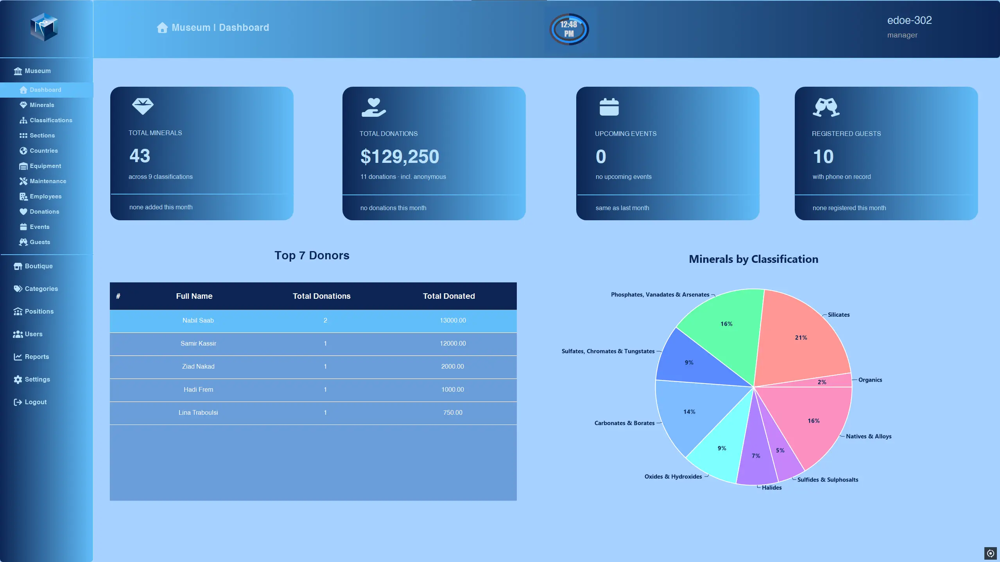
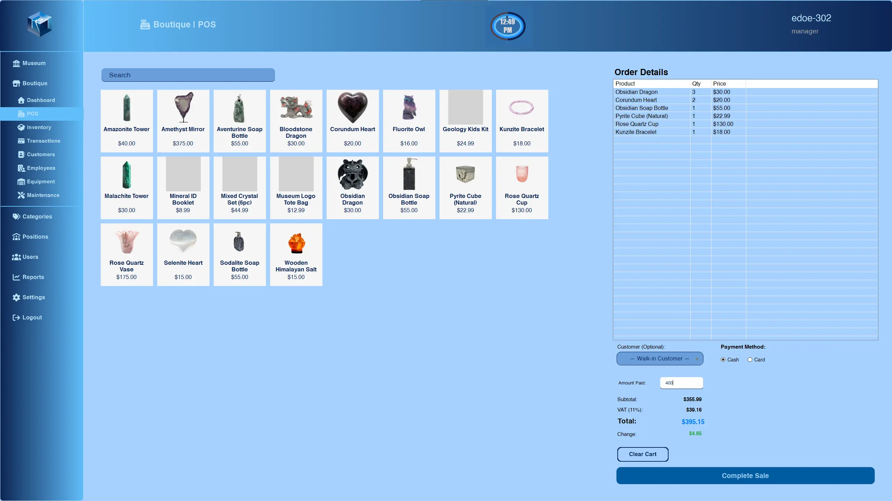
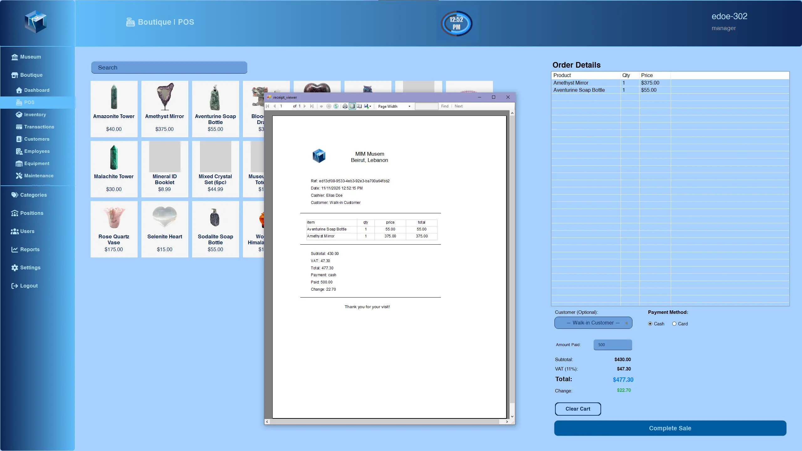

# MIM Museum Management System

A Windows desktop app for the [MIM Mineral Museum](https://www.mim.museum) in Beirut and its boutique. Built with VB.NET and SQL Server as my graduation project.

**[Read the technical write-up →](https://eli6s.dev/projects/mms)**



<table>
  <tr>
    <td></td>
    <td></td>
  </tr>
  <tr>
    <td align="center"><sub>Point of sale</sub></td>
    <td align="center"><sub>Receipt after a sale</sub></td>
  </tr>
</table>

## What it does

| Museum | Boutique |
| :-- | :-- |
| Mineral catalogue, sections, classifications | Point of sale with receipts |
| Events, guests, donations | Inventory with item photos |
| Equipment and maintenance | Customers and transaction history |

Staff log in with one of three roles, and each role sees only its own screens:

- **Manager:** everything
- **Assistant:** the museum side, except employees
- **Cashier:** POS, inventory, and the boutique dashboard, plus view-only transactions

## Default logins

| Role | Username | Password |
| :-- | :-- | :-- |
| Manager | `edoe-302` | `1234` |
| Assistant | `mdoe-303` | `1234` |
| Cashier | `jdoe-304` | `1234` |

These accounts are created by `sql/seed.sql` (see [step 4](#4-load-the-sample-data)). Usernames are not case-sensitive.

## Setup

> [!IMPORTANT]
> The app runs on Windows only. You need:
> - [Visual Studio](https://visualstudio.microsoft.com/) 2019 or later, with the **.NET desktop development** workload
> - [SQL Server](https://www.microsoft.com/sql-server/sql-server-downloads) (Express or Developer), installed as the default instance (`localhost`)
> - [SQL Server Management Studio](https://learn.microsoft.com/sql/ssms/download-sql-server-management-studio-ssms) or `sqlcmd`

### 1. Clone and add the config file

```bash
git clone https://github.com/eli6s/mim-museum.git
```

`App.config` isn't in the repo, so copy the example:

```bat
copy MimMuseum\App.config.example MimMuseum\App.config
```

### 2. Create the database

```bash
sqlcmd -S localhost -E -C -Q "CREATE DATABASE mim_museum"
```

Or in SSMS: right-click **Databases** → **New Database...** → name it `mim_museum`.

### 3. Run the app once

Open `MimMuseum.sln`, keep the build set to **Debug / Any CPU**, and press <kbd>F5</kbd>.

On startup, the app creates every table and loads the country list. Once the login screen appears, close the app. There are no users yet.

### 4. Load the sample data

```bash
sqlcmd -S localhost -E -C -d mim_museum -i sql\seed.sql
```

Or in SSMS: open `sql/seed.sql`, select `mim_museum`, and click **Execute**.

### 5. Log in

Press <kbd>F5</kbd> again and log in as `edoe-302` / `1234`.

## Configuration

<details>
<summary><b>Using a SQL Server instance other than <code>localhost</code></b></summary>

<br>

The connection string is set in [`MimMuseum/utils/db_controller.vb`](MimMuseum/utils/db_controller.vb), not in `App.config`:

```vb
Private ReadOnly conn_str As String = "Data Source=localhost;Initial Catalog=mim_museum;Integrated Security=True"
```

Change `Data Source` to `.\SQLEXPRESS` or `(localdb)\MSSQLLocalDB`, and use the same server name with `sqlcmd -S`.

</details>

<details>
<summary><b>Forgot-password emails (SMTP)</b></summary>

<br>

Password reset codes are sent by email. To send them, fill in `MimMuseum/App.config`:

```xml
<add key="smtp_host" value="smtp.gmail.com" />
<add key="smtp_port" value="587" />
<add key="smtp_email" value="you@gmail.com" />
<add key="smtp_password" value="your-app-password" />
```

For Gmail, use an [app password](https://myaccount.google.com/apppasswords). The seeded accounts have placeholder emails, so change one to a real address before testing.

</details>

<details>
<summary><b>Resetting the database</b></summary>

<br>

Run [`sql/drop.sql`](sql/drop.sql) against `mim_museum`, then repeat steps 3 to 5.

</details>

## Troubleshooting

| Problem | Fix |
| :-- | :-- |
| Can't connect to the database | Check that SQL Server is running and `mim_museum` exists ([step 2](#2-create-the-database)). |
| "Invalid username or password." | Run the seed script ([step 4](#4-load-the-sample-data)). |
| Seed fails with "Invalid object name" | Run the app once first ([step 3](#3-run-the-app-once)). |
| Missing `App.config` | Copy the example file ([step 1](#1-clone-and-add-the-config-file)). |
| `schema.sql` not found | Build with **Debug / Any CPU**. |

## Built with

VB.NET (.NET Framework 4.8) · Windows Forms · SQL Server · RDLC reports · BCrypt

## License

[GPL-3.0](LICENSE)
